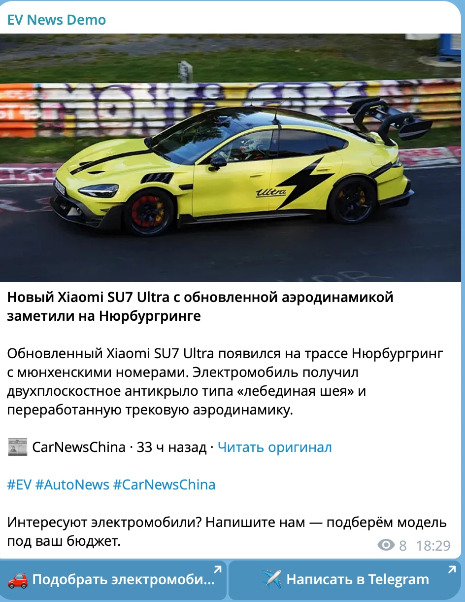

# EV News Bot


*[Русская версия](README.md)*

Telegram bot for a car-business channel. It watches EV and hybrid news from RSS feeds, keeps only the stories about the brands the business actually sells, rewrites them into natural Russian with an LLM, and posts them with a photo and an enquiry button — fully unattended.

Built for the Kazakhstan market (Chinese EV brands), but every filter is configuration, not code.

## Live demo

**[@evbotd](https://t.me/evbotd)** — a channel with sample posts produced by this bot. Posts can be read [right in a browser](https://t.me/s/evbotd), no Telegram needed.

## What a post looks like



Every post is assembled automatically: cover image from the article, headline and summary rewritten by the AI, source with the story's age, hashtags, a fixed call to action and two enquiry buttons. Both buttons open a chat with the seller and pre-fill the enquiry text with the headline of that post, so the manager instantly sees which car the customer is asking about.

When a post mentions a price, a "ℹ️ Цена указана для рынка Китая" line is appended after the summary, so a Chinese price is never read as a local one.

## How it works

```
4 RSS feeds ──> keyword filter ──> brand filter ──> freshness check ──> priority queue
 (every 30 min)   (database)        (KZ_BRANDS)      (max 24h old)      (newest first)
                                                                              │
     channel <── photo + button <── CTA + price note <── AI rewrite <── AI checks:
                                      (from config)      (Gemini)       duplicate? relevant?
```

Every AI step degrades gracefully: no API key or a failing API never drops a post, it just falls back to plain translation and lexical duplicate matching.

## Features

### Content selection

- **Brand filter** — a story is published only if one of the configured brands (Zeekr, Li Auto/LiXiang, BYD, Denza, Yangwang, Xiaomi, Avatr, Changan, Deepal) appears in its title or summary. The title wins: if it names another brand (Chery, Geely, Tesla…) and none of ours, the story is skipped even when one of ours is mentioned in the text as a competitor. The list lives in the database and is edited from Telegram with `/add_brand`; `KZ_BRANDS` in config only seeds it on first run. Word-boundary matching, so `Avatr` never matches "avatar". An empty list disables the filter.
- **Hybrid coverage** — PHEV, EREV, REEV, DM-i, DM-p and plug-in hybrid are first-class keywords, not just battery EVs.
- **AI relevance check** — before publishing, the model is asked whether the story matters to someone *choosing a car*. Model launches, specs, prices, range, reviews and test drives pass; company financials, headcount, factory construction, politics, subsidies and foreign charging infrastructure are skipped.
- **Two-level deduplication** — SQLite keyed by normalized article URL (tracking parameters stripped), plus cross-source story detection: lexical similarity picks candidates from the last 5 days (`DEDUP_WINDOW_HOURS`) and the AI decides, because word overlap alone cannot tell "BYD starts production" from "BYD halts production". Without an API key it falls back to a conservative lexical threshold.
- **Freshness guarantee** — articles older than `MAX_NEWS_AGE_HOURS` (default 24) are never published, checked again at send time in case a story waited out the window in the queue. Each post shows the article's age.
- **Priority source** — `PRIORITY_SOURCE` outranks freshness, so the feed that covers these brands best goes out first.

### Writing

- **AI rewrite** — with `GEMINI_API_KEY` set, Gemini rewrites the headline and summary into natural Russian news style. The prompt forbids inventing anything beyond the source text, and explicitly forbids claims about local availability, pricing, delivery or credit — those belong to the seller, not to a model. Thinking tokens are disabled, which keeps replies complete and cheap.
- **Translation fallback chain** — Google Translate → MyMemory → the original English headline. A translator outage never drops a post.
- **Fixed call to action** — `CTA_TEXT` is appended by code as the last line, above the buttons. The AI never sees it and cannot reword it.
- **Chinese price note** — when a post mentions an amount in yuan or dollars, `PRICE_NOTE` is appended right after the summary, so a Chinese price is never mistaken for a local one. Detection requires a number next to the currency.
- **Feed junk removal** — "The post … appeared first on …" and similar blog-engine tails are stripped before translation.

### Delivery

- **Photos** — cover image from RSS media tags, with an `og:image` fallback that fetches it from the article page (some feeds ship no images at all). No image, or a photo Telegram refuses — the post goes out as text instead of failing.
- **Caption limit** — Telegram allows 1024 characters on a photo caption; when a post would overflow, the summary is shortened on a word boundary while the headline, link and call to action stay intact.
- **Enquiry buttons** — WhatsApp (`wa.me`) and Telegram (`t.me`) side by side, both carrying the same ready-to-send message with `{title}` substituted. Configure either, both, or neither.
- **Rate limiting** — strict interval between posts, an optional daily cap, and if Telegram ever returns a flood limit the bot waits exactly as long as Telegram asks and retries.
- **Quiet hours** — optional do-not-disturb window (e.g. `23-7` in the channel's timezone): news queue up overnight and publish in the morning.

### Operations

- **Resilient fetching** — 3 retries per feed with exponential backoff, 30s timeout, separate handling for timeouts, network errors, TLS failures and malformed XML. One dead source never blocks the others.
- **AI retries** — `429` (rate limit) and `503` (model busy) are retried with 5s and 10s pauses. A daily-quota `429` fails fast instead, since that quota only resets the next day.
- **Demo mode** — `python main.py --demo [N]` publishes N fresh posts immediately and exits: no schedule, no quiet hours, no daily cap. Useful for showing the channel to a client.
- **Admin commands in Telegram** — see below.

## Engineering notes

A few places where the obvious fix was the wrong one, and what the measurements showed.

### Raising the similarity threshold disabled duplicate detection instead of tightening it

Several outlets cover the same story, so headlines were compared by the share of words they have in common. A threshold of 0.5 occasionally merged unrelated stories, so it was raised to 0.7 — seemingly stricter.

Measured against real pairs, the ranking was inverted:

| Pair | Similarity |
|---|---|
| "Tesla Model Y Gets A Price Cut" / "Tesla slashes Model Y prices" — same story | 0.50 |
| "Nio reports record Q2 deliveries" / "Nio deliveries hit record" — same story | 0.43 |
| "BYD **starts** production" / "BYD **halts** production" — **different** | 0.67 |

Different stories score higher than identical ones: the meaning hangs on a single antonym, which word overlap cannot see. A 0.7 threshold did not tighten the filter — it switched it off, letting every real duplicate through.

Lexical scoring now only shortlists candidates and the model makes the call. Dropping stop words, which inflated the denominator, lifted genuine duplicates from 0.22–0.50 to 0.43–0.57. Without an API key the old conservative threshold still applies.

### Model replies were cut off mid-sentence

The AI rewrite silently did nothing: instead of JSON it returned fragments like `72 <= 90. Accurate to facts. Lively.` — the model thinking out loud. Modern models spend the output budget on internal reasoning, so the answer never arrived (`finishReason=MAX_TOKENS`).

The fix is `thinkingConfig: {thinkingBudget: 0}`: the task needs a short JSON object, not deliberation. Replies now arrive complete in ~1.5s, and cost dropped several times over, because thinking is billed as output tokens — the expensive kind.

### The translator froze the entire bot

`deep_translator` is synchronous. Called directly from async code it blocked the only thread: while a headline was being translated the bot answered no commands and polled no updates — up to 6 seconds per post.

One line fixes it (`asyncio.to_thread(...)`), but finding it requires knowing how the event loop works: from the outside the bot looked healthy.

### Certificate verification had been switched off instead of fixed

The code carried `verify_mode = CERT_NONE` — the bot trusted any server claiming to be the source. The reason turned up too: the local Python had no root certificate store, requests failed, and verification was disabled wholesale rather than diagnosed.

The proper fix is the `certifi` bundle: the same roots on any machine, in CI and in Docker. Verification is on everywhere, and an expired source certificate now produces a clear log line instead of silent trust.

### Sound filters, combined, emptied the channel

Each filter was reasonable on its own, but they are joined by AND. On a monthly-report day the funnel looked like this:

```
70 stories in feeds → 43 passed keywords → 19 passed the brand filter
→ 7 fresh (24h) → 5 unpublished → 0 passed the AI relevance check
```

Every fresh story was a sales figure, the filter rejected them all — correctly — and the channel got nothing. The flow is narrow (11 brands, 4 feeds), so the freshness window went from 24h to 72h (7 stories versus 18) and the relevance check now accepts sales growth for a model while still rejecting financials and factories. Same day, re-measured: 0 publishable before, 9 after.

### Access control is enforced by a test, not by reading the code

One can verify `if user_id != ADMIN_ID` in every handler by eye, but the next command added is the one that will miss it.

Instead, a test walks every command registered in the bot, calls each as a stranger and requires that the bot does not reply, does not write to the database and does not toggle publishing. A command without a guard fails the build. It immediately found an inconsistency: `/delete_last` answered strangers with "Нет прав." while the rest stayed silent — a reply confirms the command exists, so it was removed.

## Admin commands

The whole bot is operated from Telegram — no config edits, no redeploys. Send these in a private chat with the bot.

| Command | What it does |
|---|---|
| `/stats` | Posts total and today, queue size, keyword count, publishing status |
| `/preview` | Renders the next unpublished story and sends it **to you**, not to the channel — the same photo, text and buttons subscribers would see |
| `/brands`, `/add_brand`, `/del_brand` | Manage the brand filter; deleting accepts a number from `/brands` |
| `/keywords`, `/add_kw`, `/del_kw` | Manage the keyword filter |
| `/sources`, `/add_source`, `/del_source` | Manage RSS feeds; a new feed is validated before it is saved |
| `/last`, `/del <n>` | List the five most recent posts and delete any of them from the channel and the database |
| `/pause`, `/resume` | Hold publishing without stopping the bot — news keep queueing |
| `/delete_last` | Shortcut for removing the most recent post |

The command list is registered with Telegram on startup for the admin chat only (`BotCommandScopeChat`), so it appears in the `/` menu for the owner and stays hidden from channel subscribers.

**Access control.** Every command answers only the account whose Telegram ID is in `ADMIN_ID`; to anyone else the bot stays silent, which does not even confirm the command exists. This is enforced by a test that walks every registered command, calls it as a stranger and asserts nothing is returned and nothing is written — so a new command added without a guard fails the build.

## Quick start

```bash
git clone https://github.com/ISkerow/ev-news-bot.git
cd ev-news-bot
python3 -m venv .venv && source .venv/bin/activate
pip install -r requirements.txt
cp .env.example .env   # fill in your values
python main.py         # or: python main.py --demo 3
```

## Configuration

Secrets and tuning go through environment variables (`.env` is supported).

### Required

| Variable | Description |
|---|---|
| `BOT_TOKEN` | Bot token from [@BotFather](https://t.me/BotFather) |
| `CHANNEL_ID` | Target channel ID (e.g. `-1001234567890`); the bot must be an admin |
| `ADMIN_ID` | Telegram user ID allowed to run admin commands |

### Lead generation

| Variable | Description |
|---|---|
| `WHATSAPP_PHONE` | Seller's WhatsApp number, digits only; empty = no WhatsApp button |
| `TELEGRAM_USERNAME` | Telegram nick for the second button, without `@`; empty = no Telegram button |
| `BUTTON_TEXT` / `TELEGRAM_BUTTON_TEXT` | Button captions |
| `WHATSAPP_MESSAGE` | Pre-filled enquiry text; `{title}` is replaced with the post headline |
| `CTA_TEXT` | Fixed call-to-action line at the end of every post; empty removes it |
| `PRICE_NOTE` | Line appended when a post mentions a price in yuan or dollars |
| `MANAGER_URL` | Legacy single-button fallback, used only when no phone and no nick are set |

### AI

| Variable | Description |
|---|---|
| `GEMINI_API_KEY` | Enables AI rewrite and the relevance/duplicate checks ([aistudio.google.com](https://aistudio.google.com)); unset = plain translation |
| `GEMINI_MODEL` | Model for all AI calls (default `gemini-3.8-flash`, see the note below) |
| `SIMILARITY_CANDIDATE` | Title similarity above which a pair is sent to the AI duplicate check (default `0.3`) |
| `DEDUP_WINDOW_HOURS` | How many hours back to look for the same story from another site (default `120`, 5 days) |
| `SIMILARITY_THRESHOLD` | Lexical duplicate threshold, used only when the AI is unavailable (default `0.7`) |

**Choosing a model.** On the Gemini free tier the newest models often answer `503` — free requests have low priority and are turned away from a busy model. The bot survives it (retries, then falls back to plain translation), but the AI rewrite will not run. If the log shows `Gemini: модель занята`, pin an older model, e.g. `GEMINI_MODEL=gemini-3.6-flash`. To list the models your key can use:

```bash
curl -s https://generativelanguage.googleapis.com/v1beta/models \
  -H "x-goog-api-key: YOUR_KEY" | grep '"name"'
```

### Scheduling and storage

| Variable | Description |
|---|---|
| `MAX_POSTS_PER_DAY` | Daily post cap counted per `TIMEZONE` day; unset = unlimited |
| `MAX_NEWS_AGE_HOURS` | Never publish articles older than this (default `72`; `0` = no limit) |
| `DEMO_FALLBACK` | `true` lets `--demo` top up with stories the relevance filter rejected, when relevant ones run out (default `false`) |
| `QUEUE_GRACE_HOURS` | Extra hours granted to articles already waiting in the queue (default `12`) |
| `QUIET_HOURS` | Do-not-disturb window as `start-end` hours, e.g. `23-7` |
| `TIMEZONE` | IANA timezone for quiet hours and daily counters, e.g. `Asia/Almaty` (default `UTC`) |
| `DB_PATH` | Database file location (default `news_production.db`); point it at a mounted volume in production. `DATABASE_URL` is accepted too, including the `sqlite:///file` form |

### Lists in code

[config.py](config.py) holds `KZ_BRANDS` (the brand filter), `RSS_URLS` and `SOURCE_NAMES` (initial feeds and their display names), and `POST_DELAY`. Brands, RSS feeds and keywords are managed from Telegram at runtime — `KZ_BRANDS` and `RSS_URLS` seed the lists on first run, and keywords from [keywords.json](keywords.json) are topped up into the database on every start.

## Project structure

```
├── main.py           # entry point, queue, publishing, admin commands, demo mode
├── parser.py         # RSS fetching, filters, AI calls, translation chain
├── database.py       # async SQLite: deduplication, keywords, sources, post log
├── config.py         # configuration and the brand list
├── keywords.json     # starter keywords, topped up into the database on start
└── tests/            # 108 unit tests
```

## Tests

155 unit tests cover the keyword and brand filters, URL normalization, summary and image extraction, caption limits, post assembly, enquiry buttons, the price note, quiet hours, demo mode, admin-only access to every command, and the whole database layer. They run on every push via GitHub Actions. Line coverage is 82% (database layer 95%, configuration 84%).

```bash
pip install -r requirements-dev.txt
pytest
```

## Deployment

The bot uses long polling — no webhooks, ports, or reverse proxy needed. It runs anywhere Python runs: a VPS (`python main.py` under systemd), Railway, or Docker.

### Railway

Deploy from this GitHub repo — the `Procfile` provides the start command. Set the environment variables above, attach a volume mounted at `/data`, and set `DB_PATH=/data/news_production.db` so deduplication survives redeploys.

### Docker

```bash
docker build -t ev-news-bot .
docker run -d --name ev-news-bot \
  --env-file .env \
  -e DB_PATH=/data/news_production.db \
  -v ev_news_data:/data \
  --restart unless-stopped \
  ev-news-bot
```

The named volume `ev_news_data` keeps the SQLite database across container restarts and rebuilds.

## License

MIT — see [LICENSE](LICENSE).
